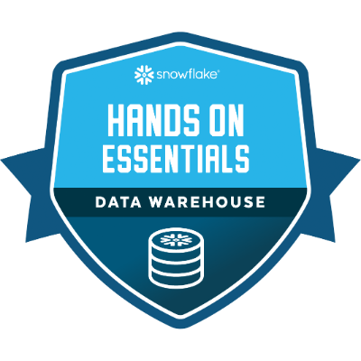

# Snowflake Hands On Essentials: Data Warehousing Workshop (Badge 1)

## Achievement

  

  🏅 <strong>Completed 10 November 2026</strong>

## Repository Contents

This repository contains my SQL scripts and notebooks which I completed as part of a Data Warehousing Workshop.

Key topics covered:
- Data warehouse concepts
- SQL querying
- Data loading and transformation
- Working with semi-structured JSON data
- Snowflake notebooks and worksheets

One of the most interesting aspects of the workshop was learning how to load and query JSON data using SQL. This provided hands-on experience with semi-structured data and helped develop a deeper understanding of modern data warehousing techniques.

